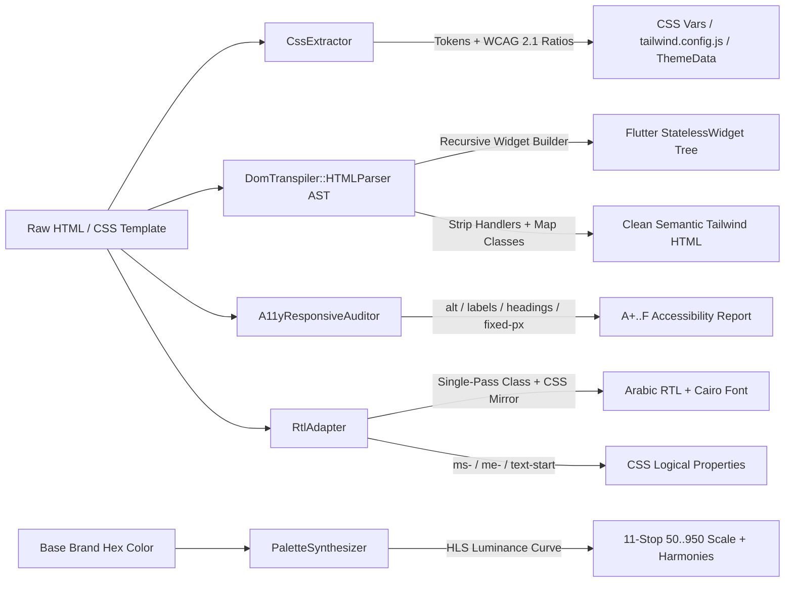

# 🎨 Nemr UI Cloner `v3.0.0` (Sovereign Edition)

### *Algorithmic 11-Stop Palette Synthesizer, WCAG 2.1 Contrast & HTML Accessibility Auditor, DOM AST-to-Flutter/Tailwind Transpiler & Arabic RTL/Logical CSS Adapter*

[](https://github.com/ElNeMeR70/nemr-ui-cloner/releases)
[](https://python.org)
[](core/component_generator.py)
[](tests/test_ui_cloner.py)
[](LICENSE)

---

## 📖 Executive Overview | نظرة عامة معمّقة

**English:**  
**Nemr UI Cloner** is a complete design-system engineering compiler for frontend web and Flutter developers. Instead of wrestling with bloated UI scrapers or heavy Node toolchains, it gives you pure Python stdlib engines to extract design tokens from any HTML/CSS file, synthesize mathematically balanced 11-stop color scales (`50`–`950`) with WCAG AA/AAA foreground text pairings, parse raw HTML markup into an AST and transpile it into idiomatic **Flutter Dart** widget trees or clean semantic **Tailwind CSS 3.4** markup, audit templates for Accessibility & mobile-overflow defects, and cleanly mirror layouts for native **Arabic RTL** and modern CSS logical properties (`ms-`, `me-`, `text-start`).

**بالعربية (الشرح الهندسي الكامل):**  
أداة **`nemr-ui-cloner`** هي محرك هندسة واجهات متكامل بيحوّل التصميمات والملفات إلى كود إنتاجي نقي وخفيف بدون اعتماديات خارجية. الأداة بتستخرج ألوان وخطوط وظلال أي صفحة، وتولّد منهجياً تدرجات ألوان كاملة من **`50` إلى `950`** متوافقة مع معايير التباين العالمية **WCAG 2.1** (`AA`/`AAA`)، وتترجم أي صفحة HTML إلى شجرة **Flutter Widgets** متجاوبة أو **Tailwind CSS 3.4** نظيف عبر **HTML DOM AST Parser** حقيقي، مع فاحص تلقائي لثغرات إمكانية الوصول (**Accessibility**) والـ Overflow على الموبايل، ومحول **Arabic RTL** ذكي في تمريرة واحدة بدون تداخل كلاسات الاتجاه أو الخصائص.

---

## 🏗️ System Architecture | معمارية النظام



---

## 🔬 Deep Dive into Core Engines | شرح تفصيلي للمحركات الداخلية

### 1. Algorithmic Palette & Harmony Synthesizer ([`core/palette_synthesizer.py`](core/palette_synthesizer.py))
Pick any single brand hex color (e.g. `#4f46e5`) and `PaletteSynthesizer` projects it into **HLS (Hue, Lightness, Saturation)** color space via `colorsys`:
- Synthesizes an 11-stop scale (`50` at `L=0.96` down to `950` at `L=0.10`) with gentle saturation softening on extreme highlights and shadows so light cards look crisp rather than neon-washed.
- Automatically computes **Complementary (`+180°`)**, **Analogous (`±30°`)**, and **Triadic (`±120°`)** harmony hex accents.
- Evaluates every single shade (`50`–`950`) against both white (`#ffffff`) and slate-900 (`#0f172a`) via WCAG 2.1 luminance contrast to assign a guaranteed readable `--{name}-{stop}-fg` foreground color!
- Exports cleanly into `:root` CSS variables, `tailwind.config.js`, Flutter `Color(0xFF...)` class constants, or structured JSON.

### 2. HTML DOM AST-to-Flutter / Tailwind Transpiler ([`core/dom_transpiler.py`](core/dom_transpiler.py))
Built on `html.parser.HTMLParser` with void-tag tracking (`img`, `input`, `br`, `hr`, `meta`, `link`), `DomTranspiler` constructs a full nested `DomNode` tree before compiling:
- **`to_flutter_widget()`**: Recursively maps `<h1>`–`<h6>` to scaled bold `Text(...)` widgets, `<button>` / `.btn` anchors to `ElevatedButton`, `<input>` to `OutlineInputBorder TextField`, `` to `Image.network`, and `flex-row`/`nav` containers to `Row` while vertical sections become `Column`.
- **`to_clean_tailwind()`**: Strips tracking attributes (`onclick`, `onload`, `data-v-*`, inline `style`) and maps bare semantic HTML tags (`<h1>`, `<p>`, `<input>`, `<button>`, `<a>`) into clean responsive Tailwind dark/light utilities.

### 3. Accessibility (WCAG A11y) & Mobile Overflow Auditor ([`core/a11y_auditor.py`](core/a11y_auditor.py))
Inspects HTML markup statically via `_A11yHtmlScanner` and flags 5 high-impact UI failures (`score` 0–100, grade `A+`..`F`):
- `A11Y_IMG_ALT_MISSING` (**HIGH**): Images without `alt` descriptions.
- `A11Y_EMPTY_BUTTON_OR_LINK` (**HIGH**): `<button>` or `<a>` icon controls missing both text content and `aria-label`/`title`.
- `A11Y_UNLABELED_INPUT` (**HIGH**): Form fields missing `id`, `placeholder`, `aria-label`, or `aria-labelledby`.
- `A11Y_HEADING_SKIP` (**MEDIUM**): Heading hierarchy jumps such as `<h1>` straight to `<h4>`.
- `RESPONSIVE_FIXED_WIDTH` (**MEDIUM**): Hardcoded `width: >=500px` styles or `w-[500px+]` classes lacking `max-width`/`max-w-*` responsive guards.

### 4. WCAG 2.1 Contrast Auditor & Multi-Target Exporter ([`core/css_extractor.py`](core/css_extractor.py))
Extracts hex/rgb/rgba colors, font stacks, border-radiuses, and box shadows, then computes exact W3C relative luminance contrast `(L1 + 0.05) / (L2 + 0.05)` rating colors into `AAA` (`>=7.0:1`), `AA` (`>=4.5:1`), `AA-Large` (`>=3.0:1`), or `FAIL`.

### 5. Single-Pass Bidirectional Arabic RTL & Logical CSS Engine ([`core/rtl_adapter.py`](core/rtl_adapter.py))
Multi-pass regex replacement corrupts bidirectional styles (`text-left -> text-right -> text-left`). `RtlAdapter` executes a **single-pass token/property callback**:
- Swaps Tailwind directional classes (`ml-` ↔ `mr-`, `pl-` ↔ `pr-`, `left-` ↔ `right-`, `rounded-l-` ↔ `rounded-r-`, `text-left` ↔ `text-right`) atomically.
- Mirrors raw CSS rules (`margin-left:` ↔ `margin-right:`, `padding-left:` ↔ `padding-right:`, `border-left:` ↔ `border-right:`, `text-align: left/right`, `float: left/right`).
- Injects `<html lang="ar" dir="rtl">` and Cairo Google Web Font automatically, or outputs bidirectional logical Tailwind (`ms-`, `me-`, `ps-`, `pe-`, `text-start`, `rounded-s-`) via `--logical`.

### 6. Multi-Pattern UI Component Synthesizer ([`core/component_generator.py`](core/component_generator.py))
Emits ready-to-use `card`, `hero`, `pricing`, `navbar`, and `auth` components for both Tailwind CSS 3.4+ (with dark mode variants) and Flutter `StatelessWidget` classes.

---

## 💻 Complete CLI Reference Manual | مرجع الأوامر الكامل

| Command | Arguments & Flags | Purpose |
| :--- | :--- | :--- |
| `palette` | `<#hex> [--name brand] [--export css\|tailwind\|flutter\|json]` | Generate 11-stop shade scale (`50`–`950`), harmonies & WCAG pairings |
| `audit-ui` | `<html_file> [--json]` | Audit HTML for WCAG A11y & mobile overflow issues (`A+`–`F`) |
| `clone-tokens` | `<file> [--contrast] [--export css\|tailwind\|flutter]` | Extract CSS tokens, audit contrast & export theme config |
| `transpile` | `<html_file> --target flutter\|tailwind [--widget-name Name] [--out file]` | Parse HTML DOM AST into Flutter Widget or clean Tailwind |
| `to-tailwind` | `--kind card\|hero\|pricing\|navbar\|auth --title "..." --subtitle "..." --cta "..."` | Generate Tailwind CSS component template |
| `to-flutter` | `--kind card\|hero\|pricing\|navbar\|auth --title "..." --subtitle "..." --cta "..."` | Generate responsive Flutter Dart widget template |
| `rtl-convert` | `<file> [--logical] [--out output_file]` | Mirror LTR HTML/CSS to Arabic RTL or logical `ms-`/`me-` utilities |
| `--version` | — | Print exact package version (`3.0.0`) |

### Terminal Walkthrough Examples

```bash
# 1. Generate a complete 11-stop Indigo palette with Tailwind & Flutter exports
python cli.py palette "#4f46e5" --name indigo --export tailwind
python cli.py palette "#4f46e5" --name indigo --export flutter > lib/theme/indigo_palette.dart

# 2. Audit an HTML page for Accessibility & responsive mobile bugs
python cli.py audit-ui templates/landing.html --json

# 3. Extract tokens, compute WCAG contrast scores, and export Flutter ThemeData
python cli.py clone-tokens assets/styles.css --contrast --export flutter

# 4. Transpile an existing HTML section straight into a Flutter StatelessWidget
python cli.py transpile hero_section.html --target flutter --widget-name HeroSectionWidget --out hero.dart

# 5. Convert an English LTR dashboard layout into Arabic RTL with Cairo font
python cli.py rtl-convert dashboard.html --out dashboard_ar.html
```

---

## 🐍 Programmatic Python API Usage

```python
from core import PaletteSynthesizer, A11yResponsiveAuditor, DomTranspiler, RtlAdapter, CssExtractor

# 1. Generate 11-stop accessible brand scale + complementary color
palette = PaletteSynthesizer.generate_scale("#4f46e5", name="apex")
css_vars = PaletteSynthesizer.export_scale(palette, target="css")

# 2. Check HTML quality before shipping
html = '<main><h1>Apex Dashboard</h1><button>Launch</button></main>'
a11y_report = A11yResponsiveAuditor.audit(html)
assert a11y_report["grade"] == "A+"

# 3. Transpile DOM directly to Flutter & mirror an HTML template to Arabic RTL
flutter_code = DomTranspiler.to_flutter_widget(html, widget_name="DashboardBody")
rtl_html = RtlAdapter.convert_to_rtl('<html lang="en"><head></head><body class="ml-4 text-left">...</body></html>')
```

---

## 📦 Installation & AI Agent Integration

```bash
git clone https://github.com/ElNeMeR70/nemr-ui-cloner.git
cd nemr-ui-cloner
pip install -e .
nemr-ui --version
```

Copy [`SKILL.md`](SKILL.md) to `~/.gemini/config/skills/nemr-ui-cloner/SKILL.md` for global Antigravity AI agent availability.

---

## 🎨 WCAG 2.1 Mathematics & Bidirectional RTL Engineering | معادلات الألوان واتجاه RTL

### Algorithmic Luminance & Contrast Formula
Every foreground pairing computed by `CssExtractor` and `PaletteSynthesizer` obeys the W3C WCAG 2.1 specification:
1. Convert sRGB channels ($C_{8bit} \in [0..255]$) into linearized luminance channels:
   - If $C_s \le 0.03928 \rightarrow C_{lin} = C_s / 12.92$, else $C_{lin} = ((C_s + 0.055)/1.055)^{2.4}$.
2. Compute relative luminance $L = 0.2126 R + 0.7152 G + 0.0722 B$.
3. Contrast Ratio: $(L_{\text{lighter}} + 0.05) / (L_{\text{darker}} + 0.05)$ yielding values from `1.0:1` to `21.0:1` (`>= 4.5:1` for AA body text, `>= 7.0:1` for AAA).

### Directional Swap vs Logical Utilities Reference (`RtlAdapter`)

| LTR Physical Class / CSS | Arabic RTL Mirror (`convert_to_rtl`) | Modern CSS Logical (`convert_to_logical`) |
| :--- | :--- | :--- |
| `ml-4` / `mr-6` | `mr-4` / `ml-6` | `ms-4` / `me-6` |
| `pl-3` / `pr-8` | `pr-3` / `pl-8` | `ps-3` / `pe-8` |
| `text-left` / `text-right` | `text-right` / `text-left` | `text-start` / `text-end` |
| `rounded-l-lg` / `rounded-r-lg` | `rounded-r-lg` / `rounded-l-lg` | `rounded-s-lg` / `rounded-e-lg` |
| `margin-left: 16px;` | `margin-right: 16px;` | Preserved in physical CSS |

### Why Choose AST Transpilation Over Screenshot-Only Guesswork?
Visual screenshot clones miss semantic accessibility (`alt`, `aria-label`, heading hierarchy) and break on mobile viewports (`w-[800px]`). **Nemr UI Cloner v3.0.0** inspects actual DOM trees via `HTMLParser`, audits mobile/a11y regressions with `A11yResponsiveAuditor`, synthesizes full accessible `50..950` shade palettes, and outputs clean Tailwind + Flutter Dart code ready for real applications.

---

## 📊 Feature Comparison Matrix

| Capability | Copy-Paste Snippets | Heavy Node Build Plugins | **Nemr UI Cloner v3.0** |
| :--- | :---: | :---: | :---: |
| 11-Stop HLS Scale + WCAG Pairings | ❌ | Separate CLI | ✅ `palette` Command |
| HTML DOM -> Responsive Flutter Widget | Manual Rewrite | ❌ | ✅ AST `transpile` |
| Single-Pass Bidirectional RTL + CSS Mirror | Buggy Regex | ❌ | ✅ Zero Flip-Flop Bugs |
| Static Accessibility & Mobile Overflow Grader | ❌ | Heavy Lighthouse | ✅ Instant `audit-ui` (`A+..F`) |

### Architectural Guarantees & Edge Cases Handled (أبرز المزايا الهندسية)
1. **Balanced AST Tag Closing (`DomTranspiler`)**: Unclosed void tags (``, `<input>`, `<br>`, `<hr>`) are handled explicitly in `_AstParser.VOID_TAGS`, ensuring sloppy real-world HTML never skews child Flutter widget nesting.
2. **Dark/Light Adaptive Cards**: Every Tailwind and Flutter widget emitted by `ComponentGenerator` supports automatic `dark:` classes and `Theme.of(context).brightness == Brightness.dark` switching out of the box.
3. **Safe Quote & Entity Escaping**: Single quotes inside transpiled HTML text (`'` -> `\'`) and XML/HTML entities inside clean Tailwind markup are escaped so generated `.dart` and `.html` files compile immediately without syntax errors.

### Directory Structure | هيكل المشروع

```text
nemr-ui-cloner/
├── core/
│   ├── __init__.py                 # Public v3.0.0 exports
│   ├── css_extractor.py            # CSS token parser, WCAG 2.1 contrast & theme exporter
│   ├── palette_synthesizer.py      # 11-stop (50..950) HLS scale & harmony synthesizer
│   ├── dom_transpiler.py           # HTML DOM AST -> Flutter Widget tree & Tailwind cleaner
│   ├── component_generator.py      # Multi-kind UI components (card/hero/pricing/navbar/auth)
│   ├── a11y_auditor.py             # Accessibility (alt/aria/heading) & mobile overflow grader
│   └── rtl_adapter.py              # Single-pass Arabic RTL mirror + logical Tailwind classes
├── tests/
│   └── test_ui_cloner.py           # 12 comprehensive stdlib unit tests
├── cli.py                          # `nemr-ui` CLI entry point (--version 3.0.0)
├── pyproject.toml                  # PEP 621 zero-dependency packaging
├── SKILL.md                        # Antigravity AI agent skill definition
└── LICENSE                         # MIT License
```

---

## 🧪 Verification & Tests

```bash
python -m unittest discover -s tests -v
# Ran 12 tests in 0.002s — OK
```

MIT License — Copyright (c) 2026 [Mahmoud ElNeMeR](https://elnemer-ai.com)
